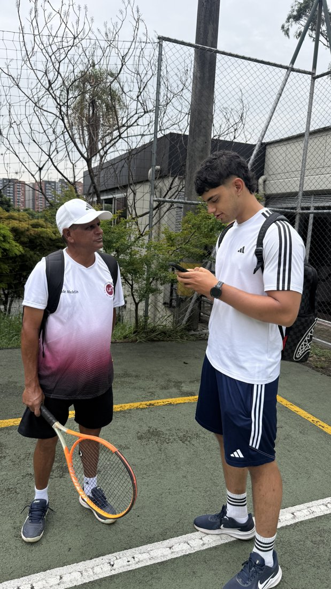
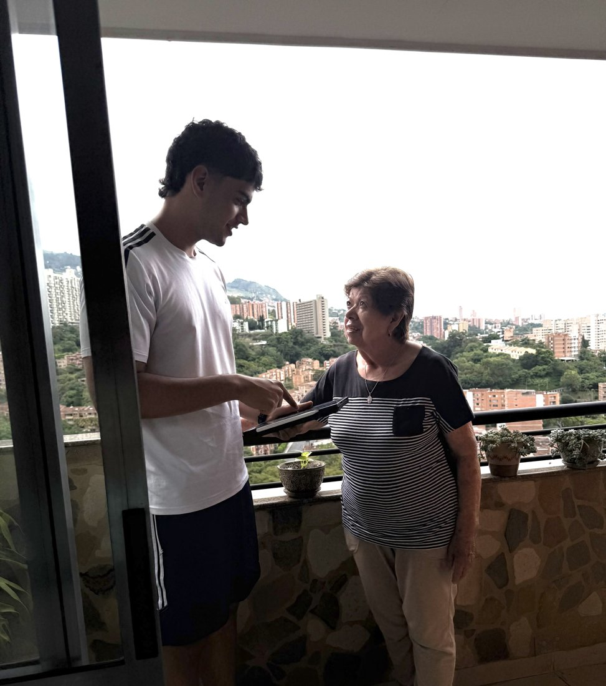
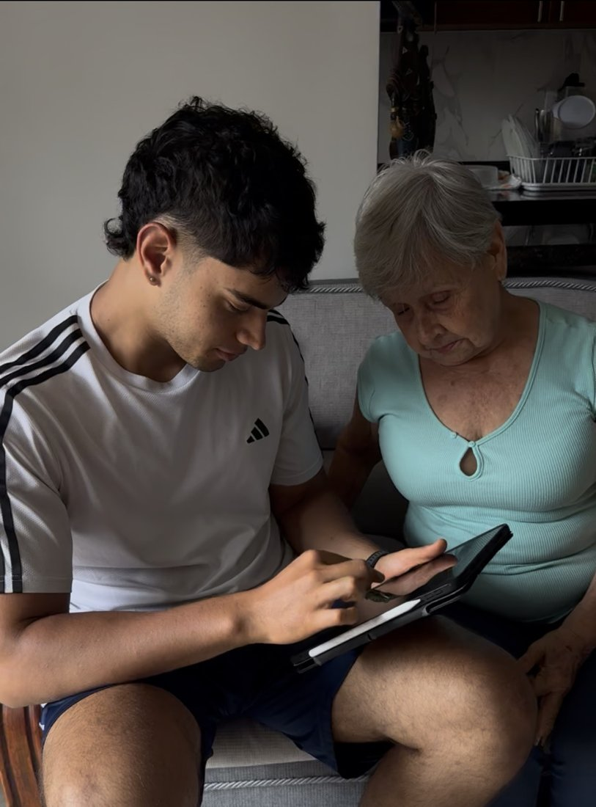

Para complementar el análisis cuantitativo, el 20 de octubre de 2026 hicimos una encuesta corta a **tres adultos mayores de La América**. Preguntamos por su nivel educativo, si tuvieron un trabajo formal, su ingreso mensual, si tienen pensión y si reciben ayudas. Los identificamos solo con un código. Son pocas personas, elegidas por conveniencia, así que no sirven para generalizar, pero muestran los mecanismos de los que habla la literatura.

| Código | Sexo | Edad | Educación | Pensión | Ocupación | Empleo formal | Ingreso mensual ($) | Ayudas |
|---|---|---:|---|---|---|---|---|---|
| E1 | Masculino | 60 | Bachillerato incompleto | No | Instructor independiente de tenis | No | 1.500.000 a 2.500.000 | No |
| E2 | Femenino | 78 | Primaria incompleta | No | Ama de casa | No | 500.000 | Sí |
| E3 | Femenino | 80 | Universitaria completa | Sí | Pensionada | Sí | 3.000.000 | No |

: Personas encuestadas en La América {.striped}

## E1: hombre de 60 años, instructor independiente de tenis, sin pensión

> «Yo trabajo dando clases particulares de tenis. No tengo un contrato formal, sino que las personas me pagan por cada clase que doy.»

> «Hay días en los que me va bien y puedo ganar unos $80.000, pero otros días tengo menos alumnos y gano mucho menos.»

> «No tengo pensión. Me ha tocado trabajar por mi cuenta y no siempre he podido cotizar para pensionarme.»

> «No recibo ayudas del Gobierno; mis gastos los cubro con lo que gano trabajando. Me ayuda que en mi juventud ahorre y tengo vivienda propia.»

## E2: mujer de 78 años, ama de casa, primaria incompleta, sin pensión

> «Me encargo de todas las labores del hogar, ayudando a mis nietos y mi hija en su dia a dia para que su vida sea mas facil y puedan salir adelante.»

> «Mis hijos me da una ayuda mensual para yo poder cubrir gastos extras que tenga, y lo que sea para mi cuidado y mantenimiento personal me lo pagan ellos.»

> «Yo estudié hasta primaria, pero no pude seguir estudiando porque tenía que ayudar en la casa y mi papa era muy machista y me sacó de la escuela.»

> «No tengo pensión porque siempre he trabajado en cosas informales.»

## E3: mujer de 80 años, educación universitaria, pensionada

> «Tuve la oportunidad de estudiar en la universidad y eso me ayudó a conseguir mejores oportunidades laborales. Ahora tengo casa propia y vivo de mi pension sola.»

> «Actualmente recibo mi pensión, que me ayuda a cubrir mis gastos mensuales.»

> «Aunque tengo una entrada fija por la pensión, debo organizar bien mis gastos para que me alcance el dinero.»

> «No dependo de ayudas económicas porque cuento con mi pensión.»

## ¿Qué nos dicen?

Las citas de E1 y E2 apuntan al mismo canal: trabajan o trabajaron en actividades informales y por eso no cotizaron. E2 además cuenta que dejó la escuela para ayudar en la casa, lo que conecta la baja educación con el trabajo informal. E3, en cambio, dice que estudiar en la universidad le dio mejores oportunidades laborales, y hoy vive de su pensión sin depender de ayudas. Esto va en la misma dirección del modelo: a mayor nivel educativo, más probabilidad de tener pensión.

## Evidencia fotográfica

Fotos del trabajo de campo en La América (20 de octubre de 2026).

::: {layout-ncol=3}

:::
